<a href="https://github.com/GeorgeMyller">
  <picture>
    <source media="(prefers-color-scheme: dark)" srcset="https://raw.githubusercontent.com/GeorgeMyller/GeorgeMyller/main/gm_terminal_dark.svg?v=1794434289">
    
  </picture>
</a>

 

[_%7C_Go-DEA584?style=for-the-badge&logo=rust&logoColor=white)](https://github.com/GeorgeMyller?tab=repositories)

---

### ⚡ Sistemas e Projetos em Destaque | Flagship Engineering Systems

| Sistema | Stack & Arquitetura | Destaques Técnicos |
| :--- | :--- | :--- |
| **[SimuladorRemap](https://github.com/GeorgeMyller/SimuladorRemap)** | `Python 3.12` · `FastAPI` · `React 18` · `Three.js` · `Rust (PyO3)` · `MLX` | Motor termodinâmico 0D/1D a 1000 Hz, telemetria WebSocket a 60 FPS, kernels nativos em Rust e calibração assistida por IA não-autorregressiva (**LAYA.ai** ~35 ms). |
| **[Sintetica](https://github.com/GeorgeMyller/sintetica)** | `Python 3.12` · `Pydantic v2` · `Asyncio` · `Node.js` · `Mypy Strict` | Framework de geração de dados sintéticos orientado por intenção conversacional (`npx github:GeorgeMyller/sintetica install`), `pii-guard` determinístico e **570 testes automatizados**. |
| **[Towerman Relay](https://github.com/GeorgeMyller/towerman-relay)** | `Go 1.24` · `X25519 ECDH` · `AES-256-GCM` · `APNs` · `Distroless` | Servidor relay WebSocket **Zero-Knowledge E2EE** compatível nativamente com Apple CryptoKit (`SealedBox`) e container multi-stage Distroless non-root. |
| **[CodeCouncil AI](https://github.com/GeorgeMyller/CodeConcilAI)** | `TypeScript` · `React 19` · `Express` · `Prisma` · `Stripe` · `Prometheus` | Plataforma SaaS multi-agente para revisão de arquitetura e auditoria de segurança com OAuth 2.0 PKCE, bilhetagem Stripe, Grafana/Prometheus e **51/51 testes de verificação**. |
| **[Autonomous Viral Factory](https://github.com/GeorgeMyller/autonomous-viral-factory)** | `Python 3.12` · `CrewAI` · `Whisper` · `FFmpeg` · `Streamlit` · `Ollama` | Pipeline multi-agente autônomo para detecção de tendências no YouTube, transcrição local via Whisper, corte inteligente e legendagem automática. |
| **[PDF to Audiobook CLI](https://github.com/GeorgeMyller/PDFAudioBook)** | `Python` · `Qwen3 (Ollama)` · `Marker-PDF` · `EdgeTTS` · `uv` | Ferramenta CLI que limpa ruídos de OCR com LLM local (Qwen3) e sintetiza audiobooks fluidos com vozes neurais de alta fidelidade. |
| **[Skill Vault](https://github.com/GeorgeMyller/Skill)** | `Spec-Driven Dev (SDD)` · `Six Hats` · `MCP Manager` · `Google ADK` | Ecossistema de Agent Skills para engenharia guiada por especificações formais, debates multi-agente estruturados e orquestração dinâmica de servidores MCP. |
